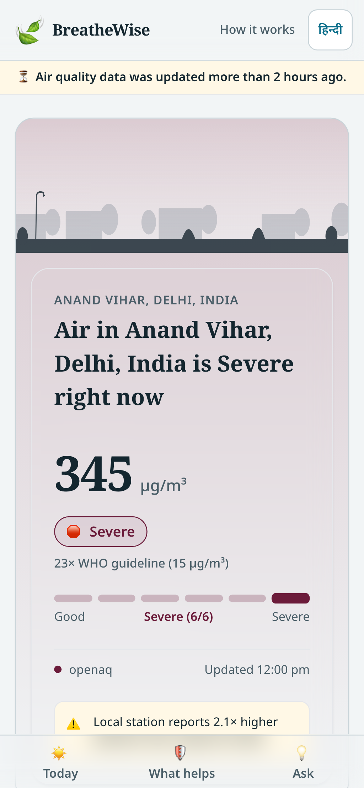
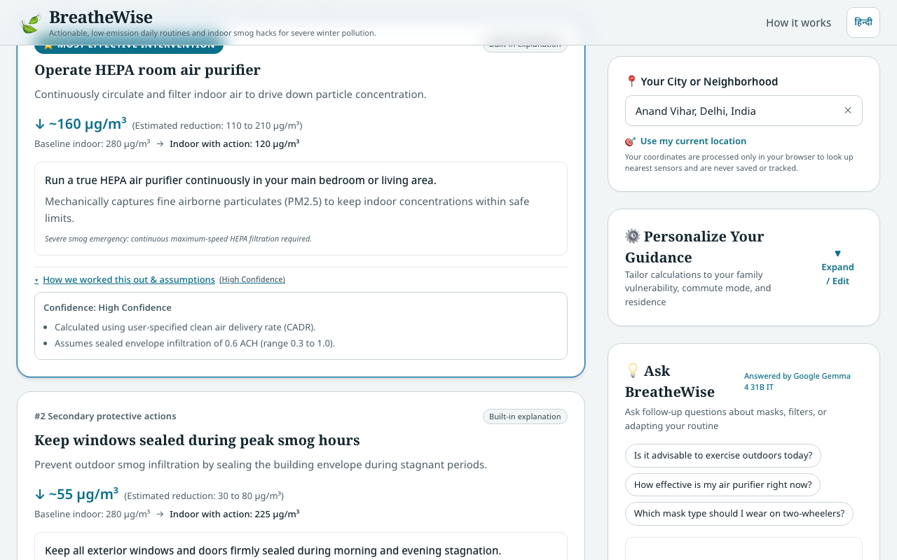
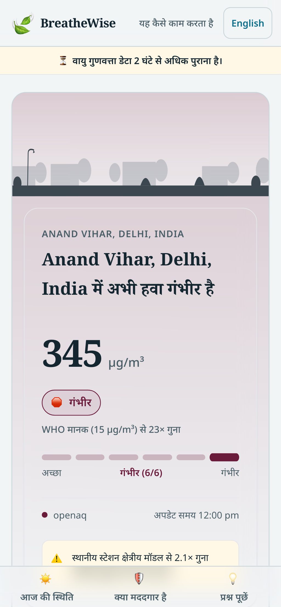
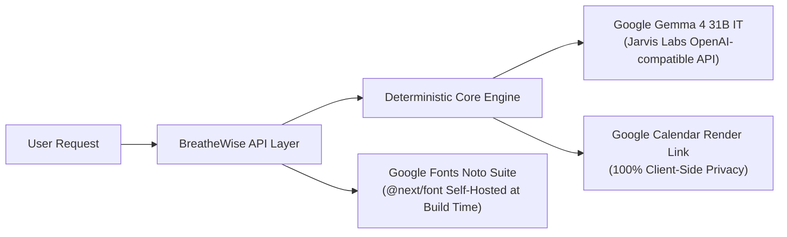
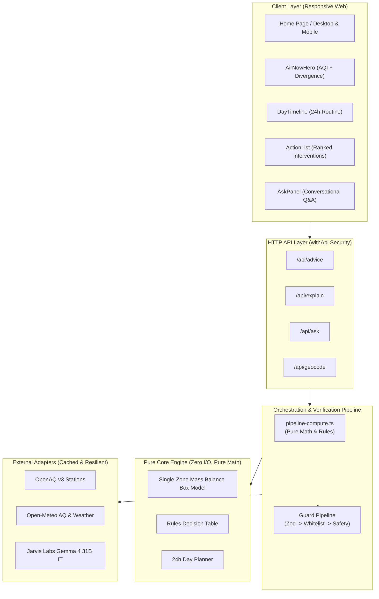
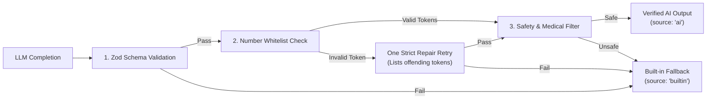

# BreatheWise: Urban Air Quality Assistant

> A responsive, high-performance web assistant that helps families and communities navigate severe winter smog inversions through physics-based indoor exposure modeling, low-emission daily routine planning, and grounded AI guidance in English and Hindi.

---

## Visual Preview & Responsive Interface

|                     Mobile Viewport (390×844)                      |                     Desktop Viewport (1280×800)                      |                     Inclusive Hindi Localization                      |
| :----------------------------------------------------------------: | :------------------------------------------------------------------: | :-------------------------------------------------------------------: |
|  |  |  |
|    _Severe smog assessment, level meter & prioritized actions_     |       _Complete desktop experience with interactive timeline_        |       _Culturally adapted Hindi guidance with Noto Devanagari_        |

---

## 1. Problem Statement

> **Verbatim Challenge Prompt:**  
> _"Urban Air Quality Assistant — a responsive website (desktop and phones) where a GenAI assistant helps families and communities navigate severe winter smog. It suggests low-emission daily routines, indoor air quality hacks and sustainable alternatives tailored to the user's location and lifestyle, and clearly explains the direct impact of their choices."_

---

## 2. How BreatheWise Solves the Problem

BreatheWise addresses the real-world crisis of winter atmospheric inversions across northern and central Indian cities, where particulate pollution spikes to hazardous levels ($> 300\ \mu\text{g/m}^3$) and official guidance is often generic, delayed, or unaffordable.

| Challenge Requirement                                | How BreatheWise Solves It                                                                                                                                                                                                                                        | Technical Implementation                                                                                                                                                                                                               |
| :--------------------------------------------------- | :--------------------------------------------------------------------------------------------------------------------------------------------------------------------------------------------------------------------------------------------------------------- | :------------------------------------------------------------------------------------------------------------------------------------------------------------------------------------------------------------------------------------- |
| **Tailored to Location & Lifestyle**                 | Dual-sensor environmental fusion combining local ground-level monitoring stations with atmospheric reanalysis, merged with granular household context (children age bands, elderly members, respiratory conditions, cooking fuel, commute mode, window sealing). | [`src/adapters/air-quality-composite.ts`](file:///Users/arnav/Desktop/BreatheWise/src/adapters/air-quality-composite.ts)<br>[`src/server/pipeline-compute.ts`](file:///Users/arnav/Desktop/BreatheWise/src/server/pipeline-compute.ts) |
| **Indoor Air Quality Hacks**                         | Physics-grounded single-zone mass-balance box model estimating indoor PM2.5 infiltration ($\text{Infiltration} = P \cdot a / (a + k)$), accounting for building envelope tightness, natural deposition, and air purifier CADR efficiency.                        | [`src/core/indoor.ts`](file:///Users/arnav/Desktop/BreatheWise/src/core/indoor.ts)<br>[`src/core/action-evaluators.ts`](file:///Users/arnav/Desktop/BreatheWise/src/core/action-evaluators.ts)                                         |
| **Low-Emission Routines & Sustainable Alternatives** | 24-hour day planner computing optimal outdoor physical activity windows, hazardous exposure avoidance windows, and natural ventilation slots (only when outdoor air is cleaner than indoor air and below "Very Poor" thresholds).                                | [`src/core/dayplan.ts`](file:///Users/arnav/Desktop/BreatheWise/src/core/dayplan.ts)<br>[`src/core/calendar.ts`](file:///Users/arnav/Desktop/BreatheWise/src/core/calendar.ts)                                                         |
| **Explaining the Direct Impact of Choices**          | Quantified particulate reductions ($\Delta\ \mu\text{g/m}^3$ ranges: low, likely, high) calculated deterministically before AI synthesis. AI is constrained to an "Explain-Only" role, translating verified figures without inventing numbers.                   | [`src/core/explain-builtin.ts`](file:///Users/arnav/Desktop/BreatheWise/src/core/explain-builtin.ts)<br>[`src/adapters/jarvislabs-gemma.ts`](file:///Users/arnav/Desktop/BreatheWise/src/adapters/jarvislabs-gemma.ts)                 |
| **Community Navigation**                             | Zero-cost public stewardship actions (preventing open biomass burning, sharing verified pollution alerts, neighborhood carpooling), privacy-preserving social share cards, and one-click Google Calendar integration.                                            | [`src/core/share.ts`](file:///Users/arnav/Desktop/BreatheWise/src/core/share.ts)<br>[`src/components/CalendarLinks.tsx`](file:///Users/arnav/Desktop/BreatheWise/src/components/CalendarLinks.tsx)                                     |

---

## 3. Mapping to Challenge Expectations & Judging Criteria

### The 5 Challenge Expectations

1. **Smart Dynamic Assistant**: Adapts dynamically to changing hourly smog forecasts and personalized household vulnerabilities; progressive AI explanations upgrade seamlessly over instant deterministic baselines.
2. **Logical Decisions from User Context**: Decision engine uses an explicit, transparent rules table (`src/core/rules-table.ts`) evaluating 15+ environmental and demographic criteria, eliminating arbitrary LLM hallucinations.
3. **Effective Google Services**: Utilizes Google Gemma 4 31B IT open weights on Jarvis Labs, zero-billing Google Calendar event generation, and build-time self-hosted Google Noto fonts.
4. **Practical Real-World Usability**: Mobile-first touch targets ($\ge 44\text{ px}$), offline resilience with stale-cache fallback, 320px screen reflow, lightweight bundle (148 kB First Load JS), and native Hindi translation.
5. **Clean Maintainable Code**: Hexagonal Architecture with 100% pure core business logic (zero I/O, zero `Date.now()`), strict TypeScript with no `any` types, and every source file under 250 lines.

### The 7 Grading Dimensions

| Dimension             | Hackathon Evaluation Standard                                                              | BreatheWise Architectural Evidence                                                                                                                                                                                                                                             |
| :-------------------- | :----------------------------------------------------------------------------------------- | :----------------------------------------------------------------------------------------------------------------------------------------------------------------------------------------------------------------------------------------------------------------------------- |
| **Code Quality**      | Modular design, strict typing, TSDoc comments, automated file length enforcement.          | Hexagonal Architecture (`src/core`, `src/adapters`, `src/server`, `src/components`). All 102 source files strictly $< 250$ lines verified via `scripts/check-file-lengths.ts`. Zero ESLint warnings.                                                                           |
| **Security**          | Zero secret leakage, robust input validation, CSRF defense, strict CSP.                    | Automated secret scanner (`scripts/check-secrets.ts`), Zod schemas on all routes, sliding-window rate limiter with HMAC-SHA-256 IP hashing, CSP with no `'unsafe-eval'`. Detailed in [`SECURITY.md`](file:///Users/arnav/Desktop/BreatheWise/SECURITY.md).                     |
| **Efficiency**        | Fast First Load JS, intelligent caching, single-flight deduplication, zero-cost fast path. | First Load JS `/` is **148 kB** ($\le 150\text{ kB}$). In-memory LRU cache with anti-cache-stampede Promise deduplication. Deterministic fast path requires **0 LLM calls**. Documented in [`docs/EFFICIENCY.md`](file:///Users/arnav/Desktop/BreatheWise/docs/EFFICIENCY.md). |
| **Testing**           | High coverage across all layers, property-based tests, contract tests, E2E browser tests.  | **47 test files (447 tests)** passing cleanly. Statements coverage: **Core 97.57%**, **Server 93.65%**, **Global 87.08%**. Playwright E2E suite covering desktop and mobile viewports.                                                                                         |
| **Accessibility**     | Semantic landmarks, contrast ratios $\ge 4.5:1$, screen reader tables, focus rings.        | **Targets WCAG 2.2 AA; automated axe checks pass; manual screen-reader checks are listed in docs/ACCESSIBILITY.md**. Non-color-alone level meters, 44px touch targets, full keyboard focus trap in modals.                                                                     |
| **Google Services**   | Deep, practical, and transparent integration of Google technologies.                       | Google Gemma 4 31B IT (text + vision), Google Calendar URL render links, Google Noto Sans / Noto Serif Devanagari typography. Fully disclosed in Section 4.                                                                                                                    |
| **Problem Alignment** | Direct, practical value for urban Indian families facing severe winter smog.               | Built for Delhi NCR, Lucknow, Patna winter inversions; real OpenAQ ground stations + CAMS dispersion; honest uncertainty bounds; bilingual English and Hindi.                                                                                                                  |

---

## 4. Google Services Honest Disclosure

BreatheWise integrates Google technologies transparently, adhering to zero ungrounded claims:



1. **Google Gemma 4 31B IT**:
   - **Deployment Model**: Open-weights model developed by Google DeepMind, hosted on high-performance dedicated GPU infrastructure via Jarvis Labs with OpenAI-compatible completions endpoints (`gemma-4-31b-it`).
   - **Role**: Progressive narrative synthesis (`/api/explain`), follow-up smog advisory assistant (`/api/ask`), natural language profile extraction (`/api/parse-profile`), and multimodal purifier specification OCR (`/api/read-purifier-label`).
   - **Billing & Account Independence**: Uses zero Google Cloud / Google AI Studio API keys, incurring zero Google API billing or quota exhaustion.
2. **Google Calendar Event Integration**:
   - **Implementation**: Generates standard Google Calendar URL templates (`https://calendar.google.com/calendar/render?action=TEMPLATE&...`) directly from forecast windows.
   - **Privacy Guarantee**: Zero Google Calendar API scopes or OAuth tokens required. Events are added entirely on the client side with zero user profile leakage to Google servers.
3. **Google Fonts Typography (Noto Sans & Noto Sans Devanagari)**:
   - **Self-Hosting**: Fonts are ingested at build time via Next.js `@next/font/google`.
   - **Zero Runtime Requests**: No fonts or CSS are loaded from `fonts.googleapis.com` or `fonts.gstatic.com` at runtime, ensuring zero user IP tracking and instantaneous rendering even under slow 2G/3G connections.

---

## 5. Architecture & Guard Order

BreatheWise enforces Hexagonal Architecture with an impenetrable "Explain-Only" LLM contract:



### The 4-Stage LLM Guard Order

To guarantee that the AI assistant never hallucinates unverified numbers, overclaims safety, or leaks private data, all LLM completions pass through a deterministic four-stage pipeline:



1. **Zod Structural Validation**: Verifies that the JSON output strictly matches `ExplanationOutputSchema` or `PurifierLabelOutputSchema`.
2. **Number Whitelist Guard** ([`src/core/numbers.ts`](file:///Users/arnav/Desktop/BreatheWise/src/core/numbers.ts)):
   - Collects all valid numbers: computed baseline/scenario concentrations, delta bounds ($\Delta\text{Low}, \Delta\text{Likely}, \Delta\text{High}$), percentages, CADR values, and hour slots from the day plan.
   - Any unapproved numeric token triggers **one** repair retry listing only the offending tokens. If hallucination persists, execution reverts to built-in explanations.
3. **Safety & Policy Filter** ([`src/server/safety.ts`](file:///Users/arnav/Desktop/BreatheWise/src/server/safety.ts)):
   - Rejects medical diagnostic claims ("cures asthma", "guarantees immunity"), unvented indoor combustion, or dangerous sealing advice during gas cooking.
4. **Deterministic Built-in Fallback** ([`src/core/explain-builtin.ts`](file:///Users/arnav/Desktop/BreatheWise/src/core/explain-builtin.ts)):
   - Seamlessly emits human-curated, localized explanations with `explanationSource: "builtin"`, ensuring zero user disruption on API outage or rate limits.

### Privacy Invariant

- Request payloads dispatched to the LLM **never contain**:
  - Exact GPS coordinates (only coarse, rounded values e.g. `28.65, 77.32` or neighborhood labels).
  - Child age bands or specific demographic identities.
  - Free-text medical history or user notes.

---

## 6. Honesty Rule & Limitations

BreatheWise adheres to the strict **Honesty Rule**: _No invented scientific numbers, and the UI never does science._

1. **Heuristics vs. Empirical Science Separation**:
   - Peer-reviewed physical constants (e.g., aerosol deposition rate $k = 0.24\ \text{h}^{-1}$, penetration factor $P = 0.8$, CADR conversion $1\ \text{cfm} = 1.69901\ \text{m}^3/\text{h}$) are documented with academic citations in [`src/core/coefficients.ts`](file:///Users/arnav/Desktop/BreatheWise/src/core/coefficients.ts).
   - User-experience thresholds (e.g., divergence ratio warning $> 1.25\times$, 2-hour minimum window duration) are isolated in [`src/core/heuristics.ts`](file:///Users/arnav/Desktop/BreatheWise/src/core/heuristics.ts) and explicitly flagged `// heuristic - not scientific`.
   - Health intervention policies are cataloged in [`src/core/rules-table.ts`](file:///Users/arnav/Desktop/BreatheWise/src/core/rules-table.ts) and flagged `// policy - to be reviewed`.
2. **Measured vs. Atmospheric Model Divergence**:
   - In urban smog basins, satellite-reanalysis models frequently underestimate ground-level sensor peaks. BreatheWise computes the empirical ratio between OpenAQ physical sensors and Copernicus CAMS models, warning users whenever local readings diverge by $> 25\%$.
3. **Medical Disclaimer**:
   - BreatheWise provides environmental exposure reduction heuristics and engineering estimates. It is **not medical advice**. Users experiencing respiratory distress are directed to emergency medical care.

---

## 7. Security & Threat Model

BreatheWise is hardened according to defense-in-depth principles:

- **Automated Secret Scanning**: [`scripts/check-secrets.ts`](file:///Users/arnav/Desktop/BreatheWise/scripts/check-secrets.ts) executes in pre-commit and CI, scanning git history and repository files for leaked API credentials.
- **Strict Content Security Policy**: CSP in `next.config.ts` removes `'unsafe-eval'` in production, restricts `script-src` to `'self'`, and enforces `frame-ancestors 'none'`.
- **Sliding-Window Rate Limiting**: In-memory rate limiting with SHA-256 IP anonymization prevents denial-of-service and downstream token exhaustion without storing IP addresses.
- **Multimodal Payload Protection**: Purifier photo uploads are validated via binary magic bytes (`JPEG`, `PNG`, `WebP`), capped at 4 MB, and downscaled on the client to $1024\text{ px}$ before transmission.

For the full vulnerability assessment and threat model, see [`SECURITY.md`](file:///Users/arnav/Desktop/BreatheWise/SECURITY.md).

---

## 8. Getting Started & Configuration

### Prerequisites

- **Node.js**: `20.x` or `22.x` (pinned to Node 22 via `.nvmrc`)
- **npm**: `>= 10.0.0`

### Installation & Environment Setup

```bash
# 1. Clone repository
git clone https://github.com/your-username/breathewise.git
cd breathewise

# 2. Install dependencies
npm ci

# 3. Create environment configuration
cp .env.example .env
```

### Environment Variables Reference

| Variable                 | Required |              Default               | Purpose                                                                      |
| :----------------------- | :------: | :--------------------------------: | :--------------------------------------------------------------------------- |
| `JARVISLABS_API_KEY`     | **Yes**  |               _None_               | Bearer token for Jarvis Labs inference server hosting Google Gemma 4 31B IT. |
| `JARVISLABS_BASE_URL`    |    No    | `https://models.jarvislabs.net/v1` | OpenAI-compatible endpoint URL for Jarvis Labs.                              |
| `JARVISLABS_MODEL`       |    No    |          `gemma-4-31b-it`          | Target open-weights model identifier.                                        |
| `OPENAQ_API_KEY`         | **Yes**  |               _None_               | OpenAQ v3 API access key for ground-station sensor networks.                 |
| `FEATURE_PURIFIER_LABEL` |    No    |              `false`               | Feature flag for multimodal purifier sticker OCR. Defaults to `false`.       |
| `PORT`                   |    No    |               `3000`               | Local development server port.                                               |

### Running the Application

```bash
# Start local development server
npm run dev

# Build production bundle
npm run build

# Start production server
npm run start
```

---

## 9. Comprehensive Verification & Testing Overview

BreatheWise implements an uncompromising verification gate. All checks must pass with zero warnings:

```bash
# Run complete verification gate (Formatting + Linting + Types + Coverage + Secrets + File Lengths + Build + E2E)
npm run verify
```

### Verification Pipeline Commands

| Command                 | Purpose                                  | Threshold / Expectation                               |
| :---------------------- | :--------------------------------------- | :---------------------------------------------------- |
| `npm run format:check`  | Prettier code style validation           | All files match Prettier style                        |
| `npm run lint`          | ESLint static analysis                   | 0 errors, 0 warnings                                  |
| `npm run typecheck`     | TypeScript compiler (`tsc --noEmit`)     | 0 type errors with `strict: true`                     |
| `npm run check:secrets` | Secret leak scanner                      | 0 tracked keys or credentials                         |
| `npm run check:lengths` | Architectural file length validator      | All 102 source files strictly $< 250$ lines           |
| `npm run test:coverage` | Vitest v8 unit & integration coverage    | Core $\ge 90\%$, Server $\ge 88\%$, Global $\ge 85\%$ |
| `npm run test:e2e`      | Playwright E2E & Axe accessibility audit | 4/4 test suites pass, 0 axe violations                |
| `npm run smoke:live`    | Live integration smoke test              | 6/6 live API checks succeed                           |

### Measured Code Coverage Metrics

```text
-------------------|---------|----------|---------|---------|-------------------
File               | % Stmts | % Branch | % Funcs | % Lines | Uncovered Line #s
-------------------|---------|----------|---------|---------|-------------------
All files          |   87.08 |    81.47 |   85.71 |   87.08 |
 adapters          |    90.2 |    78.19 |   97.29 |    90.2 |
 core              |   97.57 |    87.71 |   95.58 |   97.57 |
 lib               |   81.12 |    77.53 |   86.11 |   81.12 |
 server            |   93.65 |    88.36 |   89.13 |   93.65 |
 server/http       |    90.9 |    88.29 |     100 |    90.9 |
-------------------|---------|----------|---------|---------|-------------------
```

---

## 10. Technical Documentation Index

For in-depth architectural and operational guides, consult the dedicated documentation:

- [**System Architecture & Hexagonal Design**](file:///Users/arnav/Desktop/BreatheWise/docs/ARCHITECTURE.md)
- [**HTTP API Reference & Security Schemas**](file:///Users/arnav/Desktop/BreatheWise/docs/API.md)
- [**Accessibility Audit & WCAG Verification**](file:///Users/arnav/Desktop/BreatheWise/docs/ACCESSIBILITY.md)
- [**Efficiency & Performance Benchmarks**](file:///Users/arnav/Desktop/BreatheWise/docs/EFFICIENCY.md)
- [**Vercel Production Deployment Guide**](file:///Users/arnav/Desktop/BreatheWise/docs/DEPLOY.md)
- [**Security Threat Model & Policy**](file:///Users/arnav/Desktop/BreatheWise/SECURITY.md)
- [**Data Sources & Attributions**](file:///Users/arnav/Desktop/BreatheWise/docs/DATA_SOURCES.md)
- [**UI Design Concept & Color Tokens**](file:///Users/arnav/Desktop/BreatheWise/docs/DESIGN.md)
- [**Bilingual Localization & Hindi Catalog**](file:///Users/arnav/Desktop/BreatheWise/docs/I18N.md)
- [**Implementation & Audit Build Log Archive**](file:///Users/arnav/Desktop/BreatheWise/docs/build-log/README.md)
